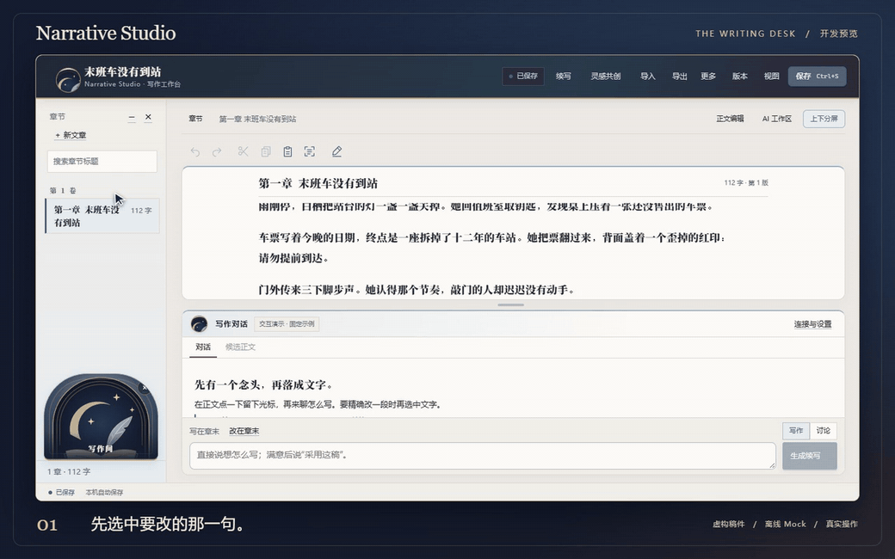

# Narrative Studio · 写作间

**这一句，由你决定要不要改。**

导入一篇旧稿，选中那句一直不满意的话。告诉 AI 你想怎么改，对照候选，再决定要不要换掉原文。也可以带来一句灵感，从人物、关系一路写到开篇。

[看实录短片](https://willow-tokoton-hitorineko.github.io/narrative-studio/#film) · [快速试用](#快速试用) · [开发预览](https://github.com/Willow-Tokoton-Hitorineko/narrative-studio/releases/tag/v0.1.0-preview.2)

## 一句话是怎么改的

<picture>
  <source media="(prefers-reduced-motion: reduce)" srcset="docs/media/film-poster.png">
  
</picture>

_《末班车没有到站》为虚构样稿。操作在真实工作台完成，生成内容来自离线 Mock。_ [视频与播放控制](https://willow-tokoton-hitorineko.github.io/narrative-studio/#film) · [静态画面](docs/media/film-poster.png)

- **接着旧稿写**。在光标处续写，或只改选中的一段。采用时保存版本和来源，随时撤销。
- **从灵感开始**。自由聊，也可以按卡片一步步梳理人物、关系和剧情。确认后把方案带进开篇。
- **安静写一会儿**。导入 TXT 或 Markdown，在本机写、改、保存，随时导出。

## 快速试用

需要 Node.js 24、pnpm 11 和桌面浏览器。以下命令从项目根目录运行。

```sh
git clone https://github.com/Willow-Tokoton-Hitorineko/narrative-studio.git
cd narrative-studio
pnpm install --frozen-lockfile
pnpm build
pnpm studio:build
pnpm demo
```

用浏览器打开终端打印的完整本地链接，点「接着已有文章写」。试着输入「续写门外的动静」，然后点击「生成续写」。示例在独立临时目录运行，无需密钥。每次启动会创建一份新样稿。

[建立自己的 Vault、导出和配置 DeepSeek](docs/quickstart.md)

## 谁能改动正文

- 手动编辑及离线演示可以在本机运行。切换到真实 DeepSeek 后，明确授权的上下文会发给配置的模型服务，可能计费。配置保存在本地服务端进程。
- 模型生成候选，作者确认写入。确认时复核原文版本与目标范围，正文已经变化时需要重新生成。正式人物关系同样由作者确认。
- 文学检查给出规则提示，已批准的样本可作为文风上下文。文学质量由作者判断。

## 验证与进度

目前是 **开发预览**，工作台以中文为主，从源码构建。首发在 Windows 11 验证了双端构建、类型检查和 137 项测试。Windows Edge 后台实测覆盖示例导入、预览隔离、确认写入、撤销恢复及进入分步构思。本次公开演示使用 Mock，真实 DeepSeek 未调用。[首发验证记录](docs/verification.md)

```sh
pnpm test
```

下一步聚焦长文导入后的续写手感、构思流程和本机交付体验。欢迎用虚构短文提交可复现的反馈。

由 Willow 发起，开发中使用了 AI 编程工具。软件、原创公开素材和示例以 [MIT](LICENSE) 发布。[依赖与素材说明](NOTICE)
