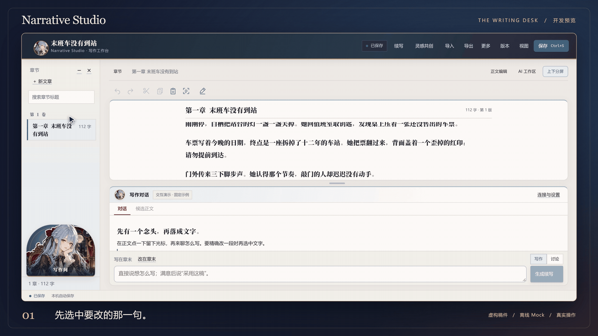

# Narrative Studio · 写作间


**给没写完的故事留一张桌子。**

再打开一篇搁了很久的稿子，最难的可能是接上上一句。写作间把正文和讨论放在同一个窗口。把光标停在断掉的地方，说说接下来想写什么。想重写一段，就圈出那几行。新稿先放在旁边，读过觉得合适，再换进正文。

[看一次改写](#一句话是怎么改的) · [用样稿试一遍](#快速试用) · [开发进度](#开发进度) · [下载源码](https://github.com/Willow-Tokoton-Hitorineko/narrative-studio/releases/tag/v0.1.0-preview.2)

## 一句话是怎么改的

<picture>
  <source media="(prefers-reduced-motion: reduce)" srcset="https://raw.githubusercontent.com/Willow-Tokoton-Hitorineko/narrative-studio/6bca961d2c0a7d86550a3df6a0ce540044f59c39/media/atelier-uhd-poster.png">
  
</picture>

末班车没来，门外却有脚步声。试着把这段改得更克制一点，再撤销一次，看看原来的文字怎样回来。录像用的是《末班车没有到站》的虚构样稿，候选来自离线演示。 [播放 4K 实录](https://willow-tokoton-hitorineko.github.io/narrative-studio/#film) · [看静态画面](https://raw.githubusercontent.com/Willow-Tokoton-Hitorineko/narrative-studio/6bca961d2c0a7d86550a3df6a0ce540044f59c39/media/atelier-uhd-poster.png)

- **续上旧稿。** 导入 TXT 或 Markdown，在光标处续写，或者选中一段改写。采纳时保存版本和来源，也能撤销。
- **把一个念头写成故事。** 先聊人物为什么要这样做，再梳理关系、主线和卷章。想清楚了就从开篇写起。
- **自己写。** 在正文里写、改、保存。需要换地方写时，把稿件导出带走。

## 快速试用

需要 Node.js 24、pnpm 11 和桌面浏览器。在终端运行下面的命令。

```sh
git clone https://github.com/Willow-Tokoton-Hitorineko/narrative-studio.git
cd narrative-studio
pnpm install --frozen-lockfile
pnpm build
pnpm studio:build
pnpm demo
```

打开终端给出的本地地址，点「接着已有文章写」。可以直接试一句「续写门外的动静，暂时别揭晓是谁」。每次运行都会新建一份临时样稿，无需密钥。

[建立自己的稿件库、导出与配置 DeepSeek](docs/quickstart.md)

## 稿件怎样保存

手写稿和离线演示都在本机运行。采纳候选前会核对选区和原稿版本。原稿已经改过时，需按新版本重新生成。正式人物关系也由作者确认。

连接 DeepSeek 是可选项。每次授权后，界面所列的上下文会发给模型服务，可能计费。文风样本由作者挑选，文学检查可供改稿时参考。

## 开发进度

当前是 **v0.1.0-preview.2 开发预览**，从源码运行。导入、改写、续写、构思和导出已经可以试用。首发的 137 项测试在 Windows 通过，浏览器验收覆盖了原稿隔离、确认写入和撤销恢复。公开演示采用离线模式。 [验证记录](docs/verification.md)

接下来优先把两条路走顺。

1. **让停下来的稿子接得上。** 用长文样稿检查导入后的章序和段落。续写时保住光标、选区和阅读位置，改过的地方也要容易找到。
2. **让开篇有东西可写。** 从一句灵感出发，先把人物的选择、冲突和关系说清楚，再整理成第一卷。回头改一个人物时，相关章节也应容易查到。

这两条流程走顺后，再缩短 Windows 上从下载、建库到打开工作台的步骤。试用中遇到卡点，欢迎带一小段可公开的样稿和复现步骤来讨论。 [提交反馈](https://github.com/Willow-Tokoton-Hitorineko/narrative-studio/issues)

Willow 发起。 [MIT 许可证](LICENSE) · [插画与许可](https://willow-tokoton-hitorineko.github.io/narrative-studio/credits.html) · [依赖说明](NOTICE)
