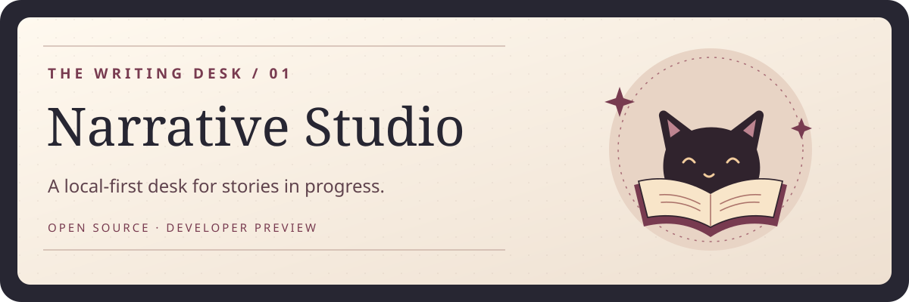
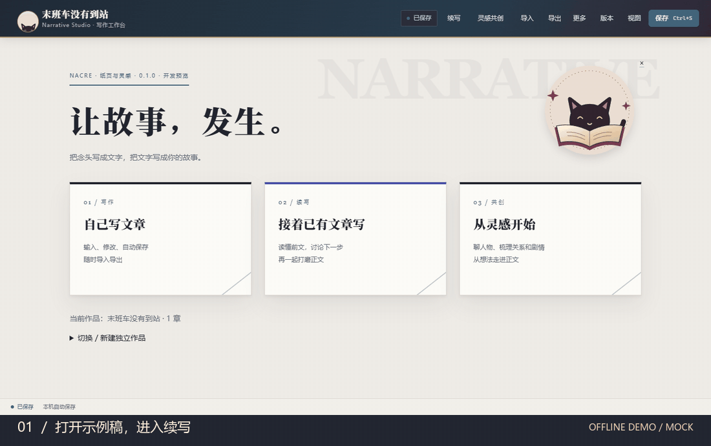

# Narrative Studio · 写作间



**把灵感聊清楚，把正文留在手上。**

Narrative Studio 是一款面向中文长篇创作的本地写作工作台。你可以导入一篇旧稿，选中一段让 AI 提出改写，也可以从一句灵感开始，慢慢梳理人物、关系与章节。候选先给你看，确认后才写进正文。

[快速试用](#快速试用) · [公开展示](https://willow-tokoton-hitorineko.github.io/narrative-studio/) · [开发预览发行版](https://github.com/Willow-Tokoton-Hitorineko/narrative-studio/releases/tag/v0.1.0-preview.1) · [反馈问题](https://github.com/Willow-Tokoton-Hitorineko/narrative-studio/issues)

## 翻开一页



_约 17 秒，Windows Edge 实拍。《末班车没有到站》是虚构样稿。画面中的 Mock 返回固定示例，用于展示操作与授权流程。_ [查看静态画面](docs/media/author-flow.png)

### 两条共创路线，一张写作桌

- **续写旧稿**。导入 TXT 或 Markdown，选中一段或定位光标。讨论走向、生成候选、预览修改，再决定替换、插入或放弃。采纳会保存版本和来源，可撤销。
- **从灵感起稿**。自由聊想法，或跟随分步卡片填写故事起点、人物、关系与剧情。整理出的方案可以编辑；关系进入正式设定前需要单独确认。
- **自己写**。在轻量正文编辑器里编辑、保存、撤销和导出。作品保存在本机 Vault，可导出为可读文本。

## 快速试用

需要 Node.js 24、pnpm 11 和桌面浏览器。以下命令从项目根目录运行。

```sh
git clone https://github.com/Willow-Tokoton-Hitorineko/narrative-studio.git
cd narrative-studio
pnpm install --frozen-lockfile
pnpm build
pnpm studio:build
pnpm demo
```

用浏览器打开终端打印的完整本地链接，点「接着已有文章写」。试着输入「续写门外的动静」，然后点击「生成续写」。示例在独立临时目录运行，无需密钥。每次启动会创建一份新样稿。

[建立自己的 Vault、导出和配置 DeepSeek](docs/quickstart.md)

## 谁能改动正文

- 手动编辑及离线演示可以在本机运行。切换到真实 DeepSeek 后，明确授权的上下文会发给配置的模型服务，可能计费。配置保存在本地服务端进程。
- 模型生成候选，作者确认写入。确认时复核原文版本与目标范围，正文已经变化时需要重新生成。正式人物关系同样由作者确认。
- 文学检查给出规则提示，已批准的样本可作为文风上下文。文学质量由作者判断。

## 验证与进度

目前是 **开发预览**，工作台以中文为主，从源码构建。首发在 Windows 11 验证了双端构建、类型检查和 137 项测试。Windows Edge 后台实测覆盖示例导入、预览隔离、确认写入、撤销恢复及进入分步构思。本次公开演示使用 Mock，真实 DeepSeek 未调用。[首发验证记录](docs/verification.md)

```sh
pnpm test
```

下一步聚焦长文导入后的续写手感、构思流程和本机交付体验。欢迎用虚构短文提交可复现的反馈。

由 Willow 发起，开发中使用了 AI 编程工具。软件、原创公开素材和示例以 [MIT](LICENSE) 发布。[依赖与素材说明](NOTICE)
